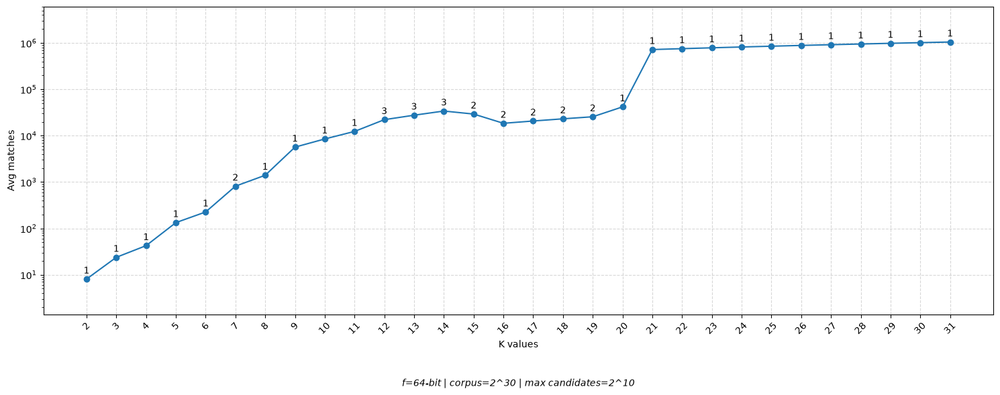
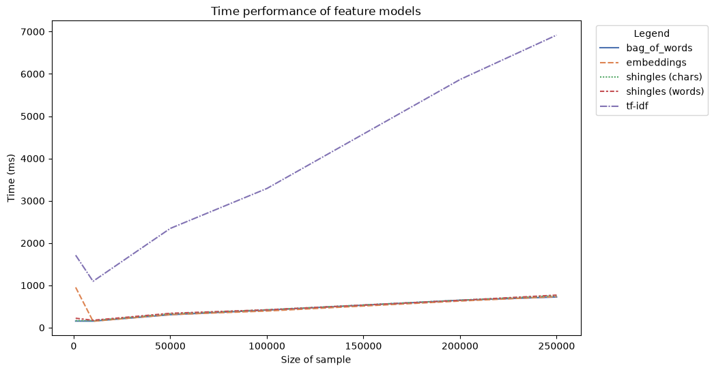
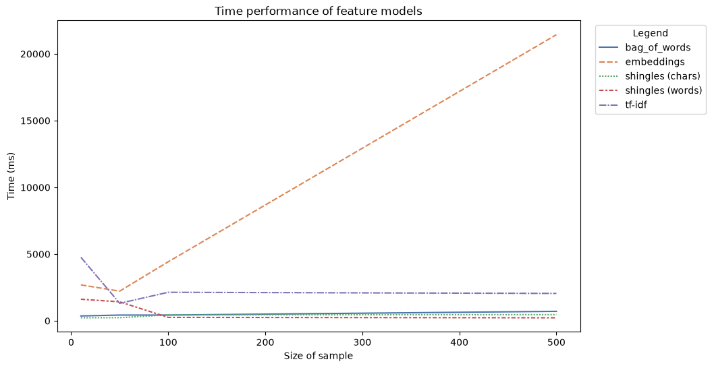
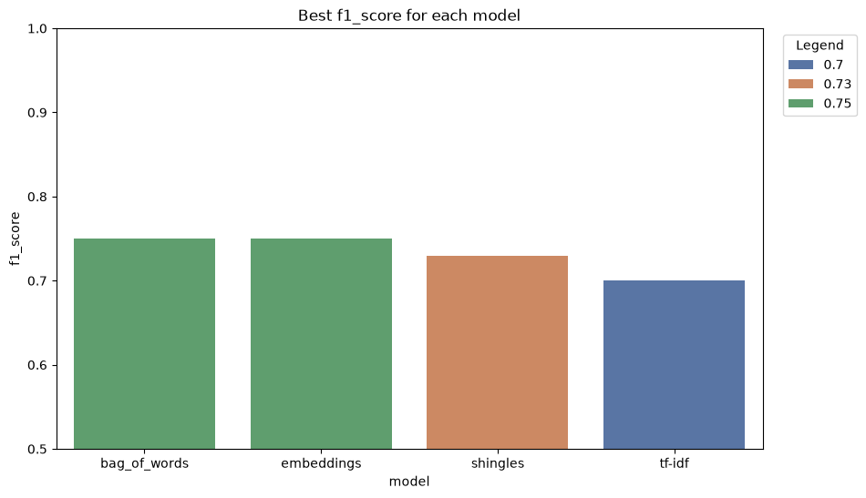
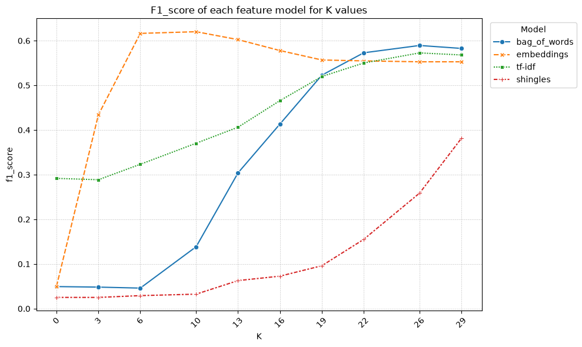
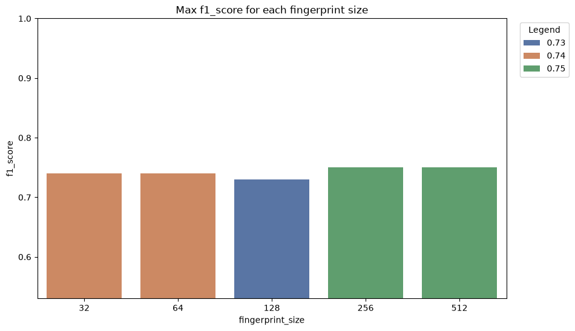
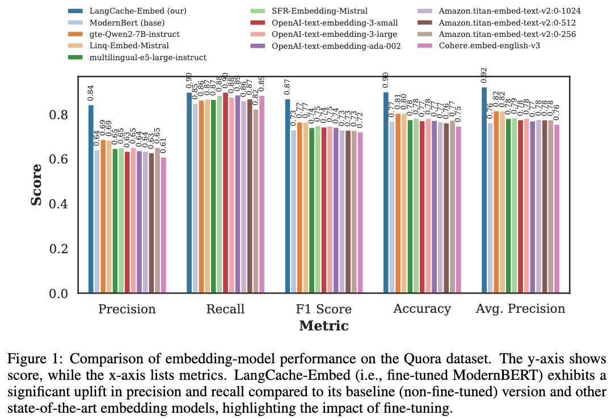
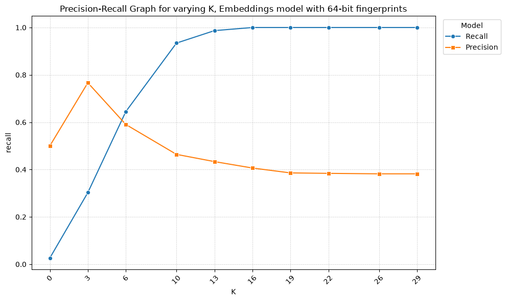
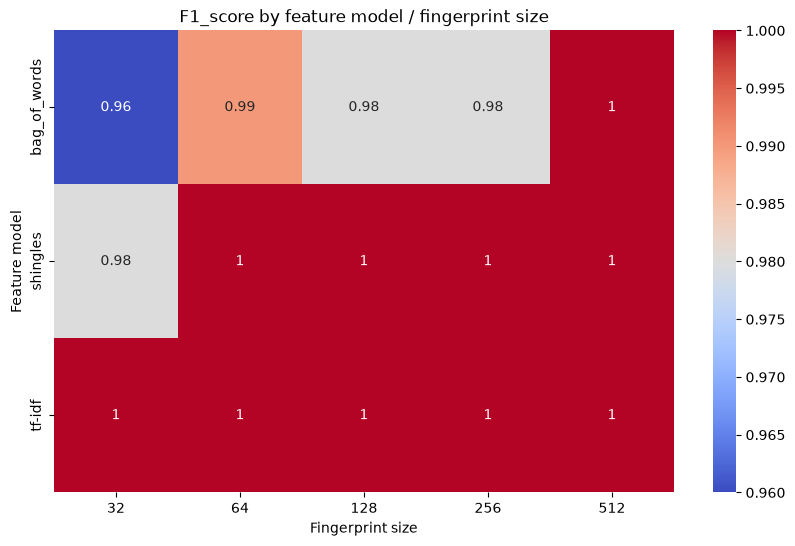
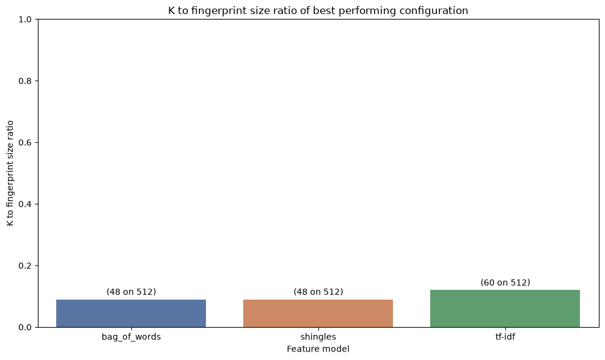

# Introduction

This work aims to answer a central question: 
given two datasets, is it possible to detect near duplicate pairs of data efficiently?

That question was originally tackled by Manku et al. [@original_paper] within the context of web crawling.

The "Definitions and Terminology" section formalizes and defines key concepts used throughout this paper.
The "Methodology" section describes the high-level logic of the proposed solution, while "Implementation" covers practical details. 
Lastly, "Results" presents an evaluation of the algorithm across multiple datasets.

# Definitions and Terminology

This section includes terms used in subsequent chapters.
Although this paper focuses exclusively on textual data (i.e., strings), the methodology applies to any data type.

- Two data are *duplicate* if they are identical, possessing the same hash digest.
- Two data are *near-duplicate* if they satisfy a specific similarity threshold, called $K$.
- A *feature* is a characteristic of some data, generated from the application of a *feature model*. 
For instance, a feature value could be $32$ and its feature model might be "the number of words in the string".
A single data might possess multiple features.
- A *fingerprint* is a fixed-length binary string that represents the content of some data.
- A *partition* is a non-overlapping substring of a fingerprint.
- A *schema* defines the number of partitions to create and how to combine them.

# Methodology

In order to understand the core problem, consider a simplified variant:
given two datasets, can exact duplicate pairs be detected efficiently? 

This easier problem can be solved by computing hash digests for every data in both datasets and performing a Cartesian product:
if two digests match then they must be duplicate (ignoring hash collisions for simplicity sake).

However, this approach fails for *near-duplicates*, as two nearly identical data can produce completely different digests.
Moreover, a Cartesian product is computationally expensive to perform on large datasets.

The following sub-sections address these limitations by replicating the methodology presented by Manku et al. [@original_paper].

## 1. Fingerprint Generation

As previously mentioned, standard hash functions cannot preserve similarity for near-duplicate detection.

To solve this, Charikar's SimHash [@simhash] algorithm is used.
Given an input string and a feature model, the SimHash algorithm can be described as follows:

1. Features are extracted from input data.
2. Each feature is hashed into a fixed-length bit vector (a *digest*).
3. All digests (of a single data) are combined into a *fingerprint* by selecting the most popular bit value across all digests at each bit position.

Selecting an appropiate feature model is crucial: 
extracting too many features slows down execution, while too little will drop detection precision.
The following subsections evaluate four different feature models.

### Bag of Words

For a given document, its features are the individual words it contains.
Two documents are considered near-duplicate if their vocabulary is similar.
This approach is computationally efficient and simple to implement, but it fails to preserve spatial locality.
For example, the document "The bank is after the office" yields the same features of "The office is after the bank".

### Shingles

A shingle is a contiguous sequence of $n$ items extracted from some document.
Items can be characters or words, and they can or cannot overlap.
Shingles are generated using a sliding window algorithm with a window size of $n$.
This model preserves locality to some extent, but it generates a large number of features, which negatively impacts performance.

### TF-IDF

Term Frequency - Inverse Document Frequency (TF-IDF) is a refinement of the *Bag of Words* approach that assigns weights to terms,
according to their rarity within a document (TF) and, inversely, in the whole dataset (IDF):
$$\text{TF-IDF}(t, d, D) = TF(t, d) * IDF(t, D)$$
where $t$ is a term, $d$ is a document and $D$ is the dataset.

TF measures local term frequency:
$$TF(t, d) = \frac{\text{How many times term t appears in document d}}{\text{Total word count of document d}}$$

Meanwhile, IDF penalizes words that are common across the dataset:
$$IDF(t, D) = \log(\frac{\text{Total number of documents in dataset D}}{\text{Number of documents containing term t}})$$

This is the feature model adopted in the original paper [@original_paper].
Although more accurate than *Bag of Words*, *TF-IDF* is computationally more expensive than previous models, 
requiring dataset-wide aggregations.
Furthermore, dataset updates introduces overhead: the weights of all terms must be readjusted.

### Embeddings {#sec-embeddings}

An embedding model is a neural architecture that maps text into a vector capturing its semantic meaning.
In this work the *Qwen3-embedding-0.6b* [@qwen3embedding] model is executed locally using Ollama.

Each weight of the generated embeddings is quantized to 0/1, using the vector median as pivot, yielding a fingerprint.
Only one feature is produced for each document, the fingerprint itself: SimHash isn't needed in this case.

The applied quantization appears lossy: this insight is explored in detail in the *qqp dataset* subsection.

## 2. Fingerprint Matching {#sec-fpmatch}

::: {layout-nrow=3}
{#fig-candidate-graph}
:::

After fingerprint generation, the target dataset (*dataset*) and the query set (*query*) are compared to find fingerprint pairs whose Hamming distance is less than or equal to a fixed threshold *K*.
Query is always assumed to be the smaller set.

Manku et al. [@original_paper] address this problem by splitting each fingerprint into $K+n$ *partitions*, for $n > 0$.
This guarantees that if two fingerprints differ by at most *K* bits then they must share at least *n* of their $K+n$ partitions.
Such pair is called a *candidate*.
Candidate pairs are then evaluated by computing their Hamming distance.

The optimal schema is computed using:
$$X(f, k, d) = \begin{cases} 
1 & \text{if } d < \tau \\ 
\min_{r > k} \binom{r}{k} \cdot X\left(\frac{f k}{r}, k, d - \frac{(r-k)f}{r}\right) & \text{otherwise} 
\end{cases}$$
where *f* denotes the fingerprint bit size, *K* is the maximum Hamming distance, *d* is the logarithmic size ($log_2$) of query and $\tau$ is the logarithmic threshold ($log_2$) for the maximum allowable candidate set.

For a similarity threshold *K*, at least $K+n$ partitions are generated.
As $K$ increases, the number of partitions grows, shrinking the partition size and expanding the number of candidates.
As shown in @fig-candidate-graph, for a 64 bit fingerprint, fixing $K$ below 8 is suggested to keep a moderate amount of candidate pairs.

The complete pipeline is structured as follows:

1. Generate $n=\binom{r}{k}$ copies of query, following the partiton schema.
2. For each copy, the partition bits are extracted and put as prefix, for all fingerprints.
3. Sort and compress fingerprints using Huffman codes.
4. Broadcast all query copies to each worker.
5. On each worker, iterate over the dataset, extracting all partitions and executing binary search over the appropriate query copy, in order to find candidates.
6. Compute Hamming distance for all candidate pairs.

# Implementation {#sec-impl}

The system is implemented using Apache PySpark [@pyspark], enabling distributed computation across nodes for large datasets.

## Feature Models {#sec-feature-models}

The processing pipeline relies on PySpark's DataFrames, using native methods from the package ```pyspark.sql.functions```.
When necessary, Pandas UDF are adopted.

### Bag of Words and Shingles

Both models were implemented natively using string methods.

### TF-IDF

TF-IDF is developed using ```pyspark.ml.features.IDF``` and ```pyspark.ml.features.CountVectorizer```. 
A custom implementation was initially developed but discarded: its performance were worse than the methods provided by the framework.

### Embeddings

In this study a transformer-based model, *Qwen3-embedding:0.6b* [@qwen3embedding] quantized to 8 bit integers (*Q8_0*), is used through Ollama.

Hardware constraints posed significant bottlenecks during embedding computation:
experiments were conducted on a Apple MacBook Air M1 with 8GB of memory, providing 11 INT8 TOPS and 68GB/s of memory bandwith.

Benchmarking on the M1 chipset demonstrated a maximum throughput of 26.5 items/sec (averaging 10 tokens per item).
Switching to an INT4 variant optimized for Apple Silicon (MLX) improved throughput to 75 items/sec.
At this throughput, processing the *qqp* dataset (considered in a later subsection) requires approximately 90 minutes.
Unfortunately, this work cannot leverage the M1 chip to the fullest:
PySpark requires a large amount of memory, forcing the usage of swap memory when running the embedding model.

By comparison, a modern desktop GPU (e.g., Nvidia RTX 5070 delivering about 500 FP4 TFLOPS and 670GB/s bandwidth) running an NVFP4 variant would process the whole dataset in less than 10 minutes.

## FastSimHash

A standard SimHash implementation uses an array of bit counters and iterates through every bit of every feature digest. 
To accelerate this algorithm, a high-performance variant was implemented using Numba to compile the native Python/NumPy program into SIMD-accelerated code.
Rather than processing individual feature bits sequentially, the algorithm operates across byte indices using 8 parallel counters per byte column. 
This design is heavily inspired from Ertl's FastSimHash [@fast_simhash], leveraging SWAR (SIMD Within A Register) operations. 
Benchmarks indicate that processing 1,000,000 64 bit feature digests requires ~14,000 ms using SimHash versus ~400 ms using FastSimHash (inclusive of initial JIT compilation overhead).

## Fingerprint Detection with RDDs

The matching process was implemented on PySpark Resilient Distributed Datasets (RDDs). 
Also, the binary search algorithm has been replaced with an hash-map lookup operation, optimizing execution time.
Huffman compression was omitted in this implementation to allow evaluation across different *K* values, though it remains recommended for production pipelines operating on fixed *K* values.

# Results

All benchmarks were evaluated on an Apple MacBook Air M1 (8GB RAM) with 8 active PySpark workers.
PySpark execution ran alongside user background applications (Safari, Ollama, VS Code). 
Dataset sample sizes were downscaled due to hardware limitations (see *Implementation - Embeddings*).

## Feature Model Runtime Comparison

::: {layout-nrow=1}
{#fig-modperf}

{#fig-modperf-small}
:::

This benchmark was run on the *llm-paraphrases* dataset.

@fig-modperf shows execution time across feature extraction models.
*Shingles* and *Bag of Words* are very efficient thanks to their fully localized computation.
On the other hand, TF-IDF presents significantly higher processing times because computing document frequencies requires a global aggregation operation, which requires data shuffle. 

Embeddings performance are very poor, as @fig-modperf-small outlines, verifying the claims of the *Implementation - Feature Models - Embeddings* subsection.

## *qqp* dataset

::: {layout-nrow=3}
{#fig-qqp-model}

{#fig-qqp-K}

{#fig-qqp-fpsize}

{#fig-qqp-embed-literature}

{#fig-qqp-precision-recall}
:::

The Quora Question Pairs (qqp) dataset serves as a benchmark for semantic near-duplicate text identification, containing over 300,000 question pairs labeled as semantic duplicates or non-duplicates.
Tests were performed on a sample of 200 pairs (100 near-duplicates and 100 non-duplicates).

@fig-qqp-model shows the maximum F1-scores obtained across different feature models. 
As expected, *Embeddings* yields the highest performance, although not by much.

@fig-qqp-K allows to inspect this behaviour: at high *K* values all feature model "degenerate", considering all pairs as duplicates.
Only *Embeddings* is actually able to distinguish semantic near-duplicates.

The peak F1-score for Embeddings ($0.75$) should be limited by binary quantization and smaller model scale. 
In benchmark comparisons from Gill et al. [@embeddingspaper] (@fig-qqp-embed-literature), unquantized state-of-the-art embedding models achieve F1-scores in the same range, disproving the idea.

@fig-qqp-fpsize shows that increasing fingerprint size beyond 64 bits yields minimal F1 improvements on this evaluation set, though larger fingerprint sizes remain essential to avoid collisions.

For 64-bit embedding fingerprints, @fig-qqp-precision-recall indicates an optimal distance parameter range from 6 to 8, which is small enough.

## *Wikipedia* dataset

::: {layout-nrow=1}
{#fig-wikipedia-model}

{#fig-wikipedia-K}
:::

This dataset is a sample of 998 paired Wikipedia entries. 
Duplicate pairs represent modified versions of original articles with about 10% injected word-level noise, while non-duplicates contain unrelated Wikipedia pages.

The *Embeddings* feature model was excluded from this benchmark because of article lengths: some exceed 87,000 characters, which saturates the available context.

@fig-wikipedia-model proves that all considered feature models achieve near-perfect classification scores on this benchmark. 

As shown in @fig-wikipedia-K, optimal performance occurs when maintaining an optimal K-to-fingerprint-length ratio near 0.1.

# Applications

The suggested near-duplicate detection algorithm supports various applications, assuming target threshold *K* remains small enough:

- Web Crawling and Storage Deduplication: Filtering redundant web pages during crawling processes, as originally considered by Manku et al. [@original_paper], or optimizing general data cleaning pipelines.
- Spam and Plagiarism Detection: Matching incoming content against databases of known spam, repetitive content, or copyrighted text.
- Content-Aware File Systems: Building storage systems that group and deduplicate documents based on syntactic or semantic similarity.

# Future explorations

- Hardware Acceleration: Expanding embedding-based deduplication to large dataset requires dedicated GPU infrastructure or high-memory machines (16GB+ RAM) to resolve the low throughput.
- Cross-Modal Feature Models: Extending the algorithm to non-textual contexts (e.g., using ASTs for source code deduplication, or multi-modal embeddings for image and video datasets).
- Edge Offloading: Moving neural embedding computations to client devices equipped with neural accelerators (e.g., Apple Neural Engine) to reduce central cluster processing.
- Finetuned Embedding Model: Replacing the adopted general purpose embedding model with a specialized, finetuned model as @fig-qqp-embed-literature from Gill et al. [@embeddingspaper] proves with *LangCache-Embed*.

# Conclusion

This work confirms that the near-duplicate detection algorithm introduced by Manku et al. [@original_paper] scales effectively, leveraging PySpark's properties, aligning with modern benchmarks.
Furthermore, using neural embeddings extends the algorithm capabilities beyond syntactic duplicate detection to semantic near-duplicate detection, keeping the optimal Hamming distance low enough.