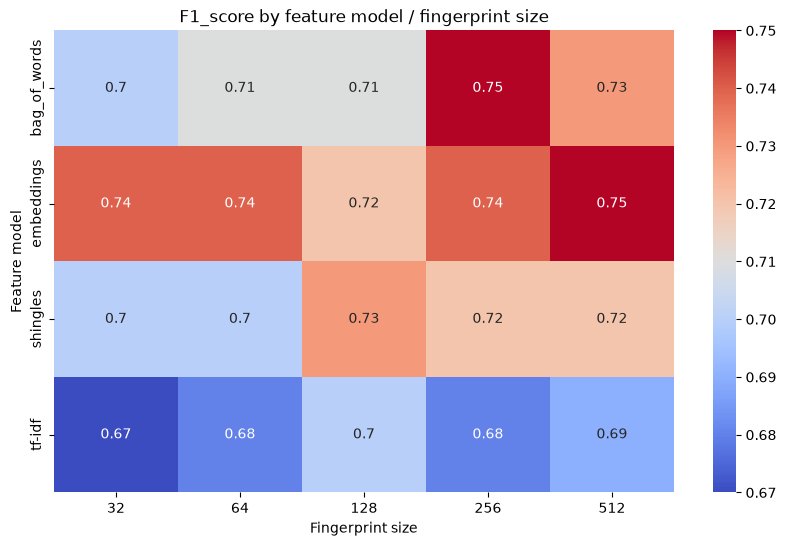
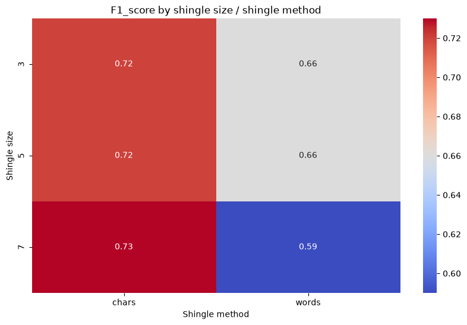

### Original paper


## Original paper (cont.)

The reference paper aims to:

- Show that Charikar's SimHash algorithm is effective to generate similar hashes for similar data;
- Present an efficient algorithm that allows to detect near-duplicates pairs, up to a (reasonably small) Hamming distance K.

In this work only the "batch" version of the proposed algorithm is implemented, using PySpark.

## Near-duplicates

::: {.callout-note}
## Definition: Near-duplicate
Two strings are considered *near-duplicates* if they are *similar enough*.
:::

Unfortunately, it's hard to pin-point the criteria and the degree that make two strings similar.
They might be similar semantically (eg. same argument, or same topic) or syntactically (eg. their words are about the same).

## Near-duplicates Detection

It's easy to check if two strings are duplicate: using hash functions, this just takes O(1) time.
However hash functions aren't strong enough to detect near-duplicates: **ever-so-slightly different strings may have wildly different digests**.

```{mermaid}
%%| fig-width: 8
%%| fig-height: 4
flowchart LR
    subgraph Data
        text1["The quick fox..."]
        text2["The nimble fox..."]
    end
    subgraph Features
        hash1["81223da6..."]
        hash2["7cb0b99c..."]
    end
    text1 -->|hash| hash1
    text2 -->|hash| hash2
```

# SimHash

## SimHash

::: {.callout-note}
## Definition: SimHash
**SimHash** is a technique for quickly estimating how similar two sets are. ^[https://en.wikipedia.org/wiki/SimHash]
:::

In this case, a set of *features* are extracted from each string of the dataset and used as input for the SimHash algorithm.

## Features

::: {.callout-note}
## Definition: Feature
A **feature** is a property of some data (i.e. a string).
:::

::: {.callout-note}
## Definition: Feature Model
A **feature model** describes what type of features properly describes some data (i.e. a string).
:::

## Features: an example

Consider the quote *"Don't worry about people stealing your ideas. If your ideas are any good, you'll have to ram them down people's throats."*. ^[https://docs.superhuman.com/mark-davis/random-quote]

A possible __feature model__ might be the set of words that appear at least two times.

In this case, the __features__ of the quote are (people, your, ideas).

## SimHash: a deeper look {.smaller}

For each string, its features are hashed and their digests are combined, taking the most popular bit value for every bit index.

The result is a string of bits that "describes" the input string, called **fingerprint**.


## FastSimHash {.smaller}

SimHash can be naively implemented using an array of counters and iterating over all digests.

It's possible to optimize it by using Numba, a Just-In-Time compiler for Python that translates Python and NumPy code into machine code, using SIMD instructions wherever possible.
Instead of iterating over all digests, it iterates over bit indexes and uses local counters (kept in CPU registers) to reduce memory updates.

Benchmark performed on 1000000 64 bit digests:

Round 1:
SimHash time: 14104 ms,
FastSimHash time: 431 ms (slower due to initial compilation)

Round 2:
SimHash time: 14247 ms,
FastSimHash time: 10 ms

## Feature models

The source paper proposed several possible feature models for this task.
Three of them have been implemented in this work, plus an original fourth one.

1. Bag of words
2. Shingles
3. TF-IDF
4. Embeddings

::: {.callout-tip}
## Which feature model did the source paper adopt?
The authors of the paper picked TF-IDF.
:::

## Feature model: Bag of Words

Each word in a text is considered a feature.
Easy to compute, but cannot detect locality: two strings containing the same words are always considered duplicate.

```{mermaid}
%%| fig-width: 8
%%| fig-height: 4
flowchart LR
    subgraph Data
        text1["Four plus three"]
    end
    subgraph Words
        word1["Four"]
        word2["plus"]
        word3["three"]
    end
    subgraph Features
        hash1["10110101..."]
        hash2["01010101..."]
        hash3["11010100..."]
    end
    text1 --> word1 & word2 & word3
    word1 --> hash1
    word2 --> hash2
    word3 --> hash3
```

## Feature model: Shingles

A feature is a contiguous series of elements in a text.
Elements can be words or characters, and can be overlapping.
It can generate a large number of features but can detect locality, to some degree.

```{mermaid}
%%| fig-width: 8
%%| fig-height: 4
flowchart LR
    subgraph Data
        text1["Dream"]
    end
    subgraph Shingles ["Shingles over chars, size 3"]
        word1["Dre"]
        word2["rea"]
        word3["eam"]
    end
    subgraph Features
        hash1["11000001..."]
        hash2["00101011..."]
        hash3["01110000..."]
    end
    text1 --> word1 & word2 & word3
    word1 --> hash1
    word2 --> hash2
    word3 --> hash3
```

## Feature model: TF-IDF {.smaller}

A more sophisticated variant of "Bag of words".
TF-IDF stands for Term Frequency - Inverse Document Frequency.
Each word is weighted for their rarity, inside its text and in the whole dataset.
Rare words have higher weights, while common words have lower weights.
It requires to re-compute all fingerprints when the dataset changes, making it heavy to compute and maintain.

```{mermaid}
%%| fig-width: 8
%%| fig-height: 4
flowchart LR
    subgraph Data
        text1["It's a fork"]
    end
    subgraph Words
        word1["It's"]
        word2["a"]
        word3["fork"]
    end
    subgraph Features ["Features and weights"]
        hash1["10101111..., 0.2"]
        hash2["01110101..., 0.05"]
        hash3["11010111..., 0.8"]
    end
    text1 --> word1 & word2 & word3
    word1 --> hash1
    word2 --> hash2
    word3 --> hash3
```

## Feature model: Embeddings

Each string is converted into a set of floating point weights, using the embedding model Qwen3-embedding:0.6b.
The fingerprint is obtained by quantizing each weight to 0/1, using the median as pivot.
Requires rather large amount of memory for long inputs.

There's no need to use SimHash here: the model provides only one feature for each string.

## Feature models performance {.smaller}

Performed on the *llm-paraphrases* dataset.

TF-IDF is the slowest model by far: it requires to create a frequency map of all words in the dataset.


# Near-duplicate batch detection algorithm

## Near-duplicate batch detection algorithm in PySpark {.smaller}

Suppose to have two fingerprint DataFrames, *query* and *dataset* (*query* is assumed to be the smaller DataFrame).

1. *query* fingerprints are split into at least K+1 partitions (Pigeonhole Principle)
2. *query* partitions are collected in a hash table and distributed to all workers, alongside *query* itself
3. Workers iterate over *dataset*, splitting each row into partitions and checking if it matches at least one of the *query* partitions
4. Fingerprint pairs with matching partitions *might* be near-duplicate: if their Hamming distance is less than K they are considered a near-duplicate pair

This algorithm prioritizes locality: only *query* fingerprints and partitions are once sent from the driver to the workers.

## Near-duplicate batch detection algorithm in PySpark: animation



## Near-duplicate batch detection algorithm in PySpark: performance

It takes 7.623 seconds to run the algorithm on a dataset of around 800,000 elements and a batch of 200,000 elements, with fingerprints of 64 bits, K=3 and 8 workers.

::: {.callout-tip}
## How does it fare against the original paper claims?
Unfortunately, it's very hard to compare them.
The algorithm described in the paper has been crafted to work exclusively with fingerprints of 64 bits and a K value of 3, 
while the algorithm implemented here works for every fingerprint size and K value.
Also, the measurements showed by the authors was performed on Google's data centers, which are much more powerful than a laptop.

The authors specified that it took less than 100 seconds to run their implementation on a dataset of 8B elements and a batch of 1,000,000 elements, using 200 workers.
:::

## Extra: why does K need to be small? {.smaller}

The graph below shows the expected number of candidates for each query row at different K values.
Higher K values forces the algorithm to adopt small partitions, which generates a large amount of candidates.


# Dataset analysis

## Semantic near-duplicates: qqp dataset analysis {.scrollable .smaller}

Industry standard as a semantic near-duplicate detection benchmark.
Small sample of 199 rows with 76 near-duplicate rows.

```{python}
#| output: asis
import pandas as pd

def truncate_chars(text, max_chars):
    text = str(text)
    if len(text) > max_chars:
        return text[:max_chars] + "..."
    return text

df = pd.read_csv("media/qqp/qqp_sample.csv")[["data1", "data2", "is_near_duplicate"]]
for col in df.columns:
    df[col] = df[col].apply(lambda x: truncate_chars(x, max_chars=30))

print(df.to_markdown())
```

## qqp: f1 score - fingerprint size


## qqp: f1 score - feature model


## qqp: feature model performance compared to literature


## qqp: f1 score - K value

Computed on 64 bits fingerprints.


## qqp: f1 score - heatmap



## qqp: f1 score - shingle variants

3-shingles over words seem more effective.



## qqp: precision - recall

The optimal K value is around 5 to 6.


## Syntax near-duplicates: wikipedia dataset analysis {.scrollable .smaller}

Dataset composed of 1000 wikipedia entries pairs.
Half of them are the same entry but with some random noise (altered words), from 5% to 10%.
The other are pairs of completely different entries.
The *Embeddings* feature model couldn't be tested: it requires more than 8GB of RAM (16GB or more should be enough though).

```{python}
#| output: asis
import pandas as pd

def truncate_chars(text, max_chars):
    text = str(text)
    if len(text) > max_chars:
        return text[:max_chars] + "..."
    return text

df = pd.read_csv("media/wikipedia/wikipedia_sample.csv")[["data1", "data2", "is_near_duplicate"]]
for col in df.columns:
    df[col] = df[col].apply(lambda x: truncate_chars(x, max_chars=30))

print(df.to_markdown())
```

## Wikipeida: f1score - feature model heatmap

All features models are strong enough to ignore syntactical noise.


## Real use-case: c5 dataset {.scrollable .smaller}

A sampled fork of the popular c4 dataset, containing Italian web pages content.
This dataset isn't cleaned, so duplicates and near-duplicates can be found.

```{python}
#| output: asis
import pandas as pd

def truncate_chars(text, max_chars):
    text = str(text)
    if len(text) > max_chars:
        return text[:max_chars] + "..."
    return text

df = pd.read_csv("media/c5/c5_sample.csv")[["data"]]
for col in df.columns:
    df[col] = df[col].apply(lambda x: truncate_chars(x, max_chars=75))

print(df.to_markdown())
```

## c5: results

From a sample of 50000 rows (170 MB), with K=3, the detected near-duplicate pairs are:

- *bag_of_words*: 32111 pairs, in 8679 ms
- *shingles*: 22220 pairs, in 9858 ms (shingle_size of 3, over words)
- *tf-idf*: 34626 pairs, in 79484 ms
- *embeddings*: OOM

## Improvements over the original paper

- Fingerprints from 32 up to 512 bits (instead of fixed 64 bits)
- K value of any size (instead of K=3)
- Four different feature models available
- Semantic near-duplicate detection
- FastSimHash

## Potential near-duplicate detection applications {.smaller}

- Remove near-duplicate pages to improve web crawling processes efficiency
- Sanitize datasets from near-duplicate entries
- Spam detection and plagiarism
- Detect malwares from a known dataset of malicious softwares
- Build advanced file systems, able to bundle together files with similar content
- ... and much more: this algorithm is not restricted to just textual data.

## Some observations {.smaller}

- Benchmarks show that fingerprint sizes are relevant only to avoid collisions on large datasets.
- The optimal K value seems to be low enough to justify the proposed algorithm for all analyzed datasets.
- The *Embeddings* model is the best feature model overall (despite the aggressive binary quantization), considering that better-performing open-source models are available.
- PySpark's optimizer may cause issues: it's good practice to check the Physical Plan of a transformation pipeline before executing it.
- Locality trumps computational complexity: the *detect_near_duplicate_batch* method has two implementations, that strive to minimize one of the two. The one that minimizes locality is generally much faster.

# Thanks!