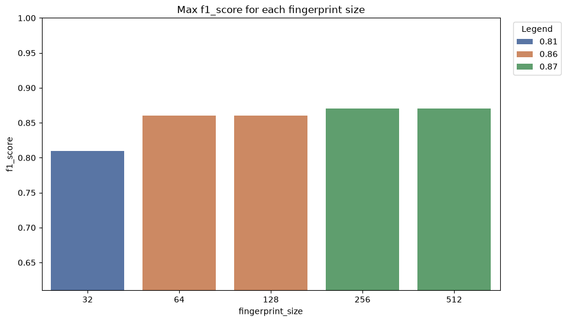

### Original paper


## Why is near-duplicates detection interesting?

- Web crawling
- Dataset sanitzation
- Spam detection and plagiarism
- Advanced file systems, capable of grouping similar files
- Antivirus softwares
- ... and much more!

## Why are they harder to detect than simple duplicates?

Duplicates are commonly detected using hash functions.

However, hash functions may return vastly different digests for very similar data.

```{mermaid}
%%| fig-width: 8
%%| fig-height: 4
flowchart LR
    subgraph Data
        text1["The quick fox..."]
        text2["The nimble fox..."]
    end
    subgraph Features
        hash1["81223da6..."]
        hash2["7cb0b99c..."]
    end
    text1 -->|hash| hash1
    text2 -->|hash| hash2
```

## How are near-duplicates detectable?

Feature models are used to extract features from data.
These features are hashed and combined into a fingerprint.
This algorithm is known as SimHash.

```{mermaid}
%%| fig-width: 8
%%| fig-height: 4
flowchart LR
    data["Data"]
    feature1["Feature"]
    feature2["Feature"]
    feature3["Feature"]
    fingerprint["Fingerprint"]
    data --> feature1 & feature2 & feature3
    feature1 --> fingerprint
    feature2 --> fingerprint
    feature3 --> fingerprint
```

## Which feature model should be used?

For textual data, four different feature models are tested in this work:

1. Bag of words
2. Shingles
3. TF-IDF
4. Embeddings

## Feature Model: Bag of words

Each word in a text is considered a feature.
Easy to compute, but cannot detect locality.
```{mermaid}
%%| fig-width: 8
%%| fig-height: 4
flowchart LR
    subgraph Data
        text1["Four plus three"]
    end
    subgraph Words
        word1["Four"]
        word2["plus"]
        word3["three"]
    end
    subgraph Features
        hash1["12f5aedc..."]
        hash2["383ef369..."]
        hash3["8b5b9db0..."]
    end
    text1 --> word1 & word2 & word3
    word1 --> hash1
    word2 --> hash2
    word3 --> hash3
```

## Feature Model: Shingles

A feature is a contiguous series of elements in a text.
Elements can be words or characters, and might overlap.
It can generate many features, resulting harder to compute, but can detect locality, to some degree.

```{mermaid}
%%| fig-width: 8
%%| fig-height: 4
flowchart LR
    subgraph Data
        text1["Dream"]
    end
    subgraph Shingles ["Shingles over chars, size 3"]
        word1["Dre"]
        word2["rea"]
        word3["eam"]
    end
    subgraph Features
        hash1["9accfb6f..."]
        hash2["c4599aab..."]
        hash3["8fcf84a3..."]
    end
    text1 --> word1 & word2 & word3
    word1 --> hash1
    word2 --> hash2
    word3 --> hash3
```

## Feature Model: TF-IDF {.scrollable}

A more sophisticated variant of "Bag of words".
TF-IDF stands for Term Frequency - Inverse Document Frequency.
Each word is weighted for their rarity, inside its text and in the whole dataset.
Rare words have higher weights, while common words have lower weights.
It requires to re-compute all fingerprints when the dataset changes, making it taxing to compute.

```{mermaid}
%%| fig-width: 8
%%| fig-height: 4
flowchart LR
    subgraph Data
        text1["It's a fork"]
    end
    subgraph Words
        word1["It's"]
        word2["a"]
        word3["fork"]
    end
    subgraph Features ["Features and weights"]
        hash1["1d315be9..., 0.2"]
        hash2["87428fc5..., 0.05"]
        hash3["24ecccc1..., 0.8"]
    end
    text1 --> word1 & word2 & word3
    word1 --> hash1
    word2 --> hash2
    word3 --> hash3
```

## Feature Model: Embeddings

Each text is converted into a set of weights, using the embedding model Qwen3-embedding:0.6b.
The fingerprint is obtained by quantizing each float weight to 0/1.
Can be memory-hungry on large texts.

## Feature Models Performance

Performed on the *llm-paraphrases* dataset, composed of short strings.
TF-IDF is the slowest model: it requires to create a frequency map of all words in the dataset.
The embedding model may perform worse than others on long strings.


## How are feature fingerprints combined?

All features of some data are combined by taking the most popular value for each bit index.
This can be sped up using FastSimHash.

```{mermaid}
%%| fig-width: 8
%%| fig-height: 4
flowchart LR
    subgraph Features
        hash1["10010100..."]
        hash2["11010111..."]
        hash3["10101011..."]
    end
    subgraph Fingerprint
        result["10010111..."]
    end
    hash1 --> result
    hash2 --> result
    hash3 --> result
```


## FastSimHash
...

## How are near-duplicates detected in PySpark? {.scrollable}

1. Fingerprints are partitioned leveraging the pigeonhole principle.
2. Fingerprints with the same partition are distributed across workers.
3. Candidates are found by probing corpus partitions using binary search (corpus partitions must be ordered).
4. Candidates having Hamming Distance higher than $K$ are discarded.

```{mermaid}
%%| fig-width: 10
%%| fig-height: 8
flowchart TD
    subgraph Data
        corpus["Corpus dataset"]
        query["Query dataset"]
    end
    subgraph Partitions ["Partitions (K=1)"]
        corpus_part1["Corpus partition 1"]
        corpus_part2["Corpus partition 2"]
        query_part1["Query partition 1"]
        query_part2["Query partition 2"]
    end
    subgraph Workers
        worker1["Worker 1"]
        worker2["Worker 2"]
    end
    subgraph Candidates
        candidates1["Candidates1"]
        candidates2["Candidates2"]
    end
    result["Near-duplicates list"]
    corpus --> corpus_part1 & corpus_part2
    query --> query_part1 & query_part2
    corpus_part1 --> worker1
    corpus_part2 --> worker2
    query_part1 --> worker1
    query_part2 --> worker2
    worker1 --> candidates1
    worker2 --> candidates2
    candidates1 -->|Hamming distance filter| result
    candidates2 -->|Hamming distance filter| result
```

## Detection time/space complexity

Considering $c$ the corpus size and $q$ the query size:
- $O(c\log{c}$ for sorting corpus partitions (can be cached)
- $O(q\log{c}$ for 

## ... what's the catch?

The graph below shows the expected number of candidates for each query row at different $K$ values.
Higher $K$ values forces the algorithm to adopt small partitions, which generate a large amount of candidates.

 {width=100%}


## Semantic near-duplicates: llm-paraphrases dataset analysis

::: {.r-stack}

<!-- Put screenshot of dataset head -->

{.fragment .fade-out fragment-index=1}

{.fragment .fade-in-then-out fragment-index=1}

{.fragment .fade-in fragment-index=2}
:::

## Syntax near-duplicates: wikipedia dataset analysis

... (screenshots)

## Real use-case: c5 dataset

... (screenshots)

## Original paper improvements

:::: {.columns}

::: {.column width="50%"}
- Fingerprints of 64 bits
- Fixed $K$ value of $3$
- TF-IDF as feature model
:::

::: {.column width="50%"}
- Fingerprints from 32 up to 512 bits
- $K$ value of any size
- Four different feature models available
- FastSimHash
- Semantic near-duplicate detection
:::
::::

# Thanks!