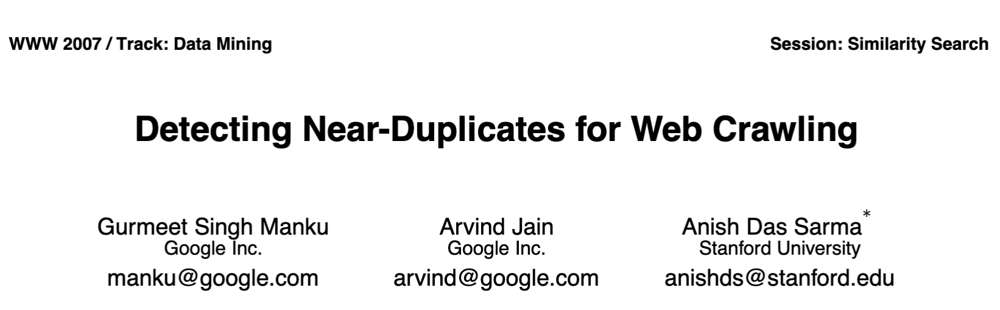

### Original paper

## Why is near-duplicates detection interesting?

- Web crawling
- Dataset sanitzation
- Spam detection and plagiarism
- Advanced file systems, capable of grouping similar files
- Antivirus softwares
- ... and much more!

## Why are they harder to detect than simple duplicates?

Duplicates are commonly detected using hash functions.

However, hash functions may return vastly different digests for very similar data.
(example)

## How are near-duplicates detectable?

Feature models are used to extract features from data.
Those features are hashed and combined into a fingerprint.
This algorithm is known as SimHash.
(example)

## Which feature model should be used?

For textual data, four different feature models are tested in this work:

1. Bag of words
2. Shingles
3. TF-IDF
4. Embeddings

## Feature Model: Bag of words

Each word in a text is considered a feature.
Easy to compute, but cannot detect locality.
(example)

## Feature Model: Shingles

A feature is a contiguous series of elements in a text.
Elements can be words or characters, and might overlap.
It can generate many features, resulting harder to compute, but can detect locality, to some degree.
(example)

## Feature Model: TF-IDF

A more sophisticated variant of "Bag of words".
TF-IDF stands for Term Frequency - Inverse Document Frequency.
Each word is weighted for their rarity, inside its text and in the whole dataset.
Rare words have higher weights, while common words have lower weights.
It requires to re-compute all fingerprints when the dataset changes, making it taxing to compute.

## Feature Model: Embeddings

Each text is converted into a set of weights, using the embedding model Qwen3-embedding:0.6b.
The fingerprint is obtained by quantizing each float weight to 0/1.
Can be memory-hungry on large texts.

## How are feature fingerprints combined?

All features of some data are combined by taking the most popular value for each bit index.
This can be sped up using FastSimHash.

## FastSimHash
...

## How are near-duplicates detected in PySpark?

1. Fingerprints are partitioned by a schema, computed at runtime.
2. Fingerprints with the same partition are distributed across workers.
3. Candidates are found by probing corpus partitions using binary search.
4. Candidates having Hamming Distance higher than $K$ are discarded.

(image)

## Semantic near-duplicates: llm-paraphrases dataset analysis

... (screenshots)

## Syntax near-duplicates: wikipedia dataset analysis

... (screenshots)

## Real use-case: c5 dataset

... (screenshots)

## Original paper improvements
:::: {.columns}

::: {.column width="50%"}
- Fingerprints of 64 bits
- Fixed $K$ value of $3$
- TF-IDF as feature model
:::

::: {.column width="50%"}
- Fingerprints from 32 up to 512 bits
- $K$ value of any size
- Four different feature models available
- FastSimHash
- Semantic near-duplicate detection
:::
::::

# Thanks!